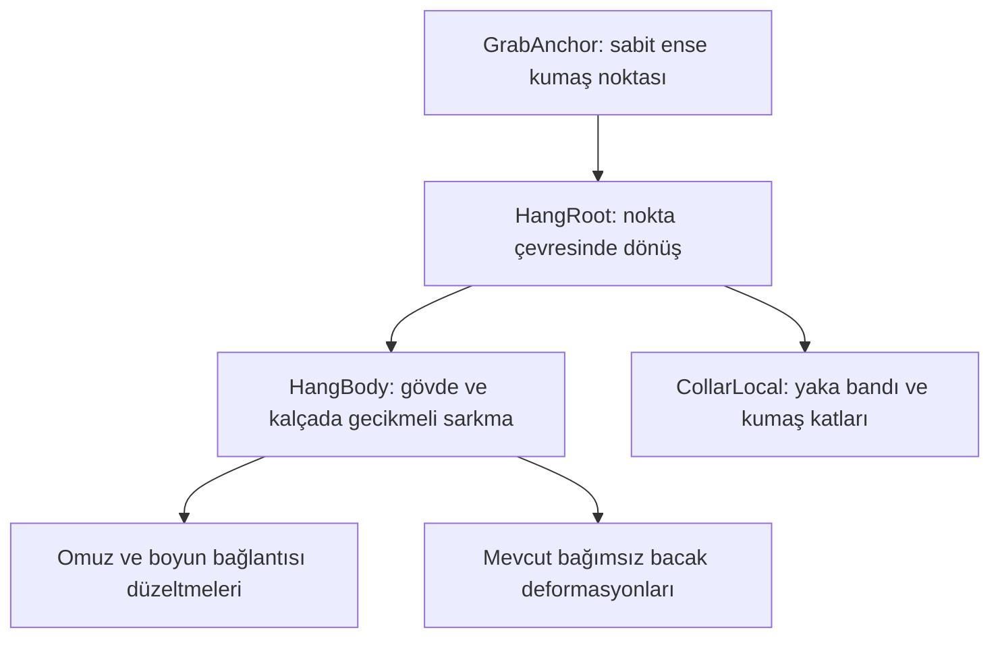

# MIKA — gerçek yaka çekilmesi tasarımı

**Durum: rig üretimine hazır teknik tasarım ve aday animasyon eğrileri; model deformasyonu henüz üretilmedi.** Bu klasördeki dosyalar mevcut `.moc3` üzerinde çalışmaz. Yeni deformer'lar ve kaynak model gerekli. Dosyaları mevcut oyunun StreamingAssets klasörüne kopyalamayın.

## Görsel hedef

Mika'nın beyaz üst giysisinin ense arkasındaki yaka bandı küçük bir tutuş bölgesinde toplanır. İmleç bu kumaş noktasını sabit tutar. Yaka kenarında dar bir tepe, tepenin iki yanından omuzlara inen gerilme çizgileri ve yakanın altında hafif üçgen kumaş katları görünür. Boyun, çene, yüz ve saç aynı kumaş deformasyonuna dahil edilmez. Giysinin önü açılmaz; cilt açığa çıkması veya giysi tasarımının değişmesi hedeflenmez.

Gövde, tutuş noktasının altında gecikmeyle aşağı yerleşir. Omuzlar hafifçe içe ve yukarı toplanırken göğüs kafesi, bel ve kalça aşağı uzanır. Bu, bütün sprite'ı dikey ölçeklemek değildir. Baş boyun bağlantısını korur; bacaklar ağırlıksız koşma pozu yerine gevşek ve asimetrik durur.

## Kaynak rig yapısı

Bu mantıksal hiyerarşi sanatçının mevcut deformer ağacına uyarlanmalı. Yaka bandı, omuz dikişleri, ense arkası kumaşı ve kat gölgeleri kaynakta ayrı ArtMesh'ler olarak erişilebilir olmalı. Ayrı değillerse katmanlı kaynak çizimden ayrılmalı ve örtülen boşluklar tamamlanmalı. Texture atlasını uzatmak veya yeni bir parametre adı eklemek bu üretimin yerini tutmaz.

### Parametre sözleşmesi

| ID | Min / nötr / max | Anahtar deformasyonlar |
|---|---|---|
| `ParamCollarPull` | 0 / 0 / 1 | 0: normal yaka; 0,5: kumaş toplanmaya başlar; 1: dar ense tutuşu, omuzlara yayılan gerilim ve kat gölgesi |
| `ParamHangBody` | 0 / 0 / 1 | 0: normal duruş; 0,5: omuzlar toplanır ve ağırlık aşağı kayar; 1: gevşek gövde, kalça ve bacak kökleriyle tam asılı poz |
| `ParamHangAngle` | −1 / 0 / 1 | Sabit GrabAnchor çevresinde sola / nötr / sağa asılma; tam uçlar için başlangıç hedefi ±8° |

`walk`, `walk2`, `walk9`, `walk8`, `walk10` bağımsız bacak/kalça hareketi için yeniden kullanılır. Aday kliplerde bu kanalların sahipliği açıkça tanımlıdır. Saç ve giysi fiziği yeni sabit tutuş noktasını sürükleyemez. Yeni üç kanal animasyon katmanına aittir; fizik ve yüz ifadesi aynı parametrelere yazamaz.

### Başlangıç geometrisi hedefleri

H = nötr karakterin görünür yüksekliği. Bunlar sanatçı üretim hedefleridir; mevcut modelde ölçülmüş sonuç değildir.

- Tutulan kumaş bölgesinin genişliği: yaklaşık 0,025–0,04 H; çevredeki yaka genişliğinden belirgin dar.
- Tam asılmada yaka ile alt gövde arasındaki ek mesafe: yaklaşık 0,025–0,04 H. Çene ve boyun anatomisi bozulmadan ayarlanmalı.
- Yaka tutuş noktası dünya konumunda sabit kalmalı. Deformasyon, kumaşı bu noktanın altına doğru gerer.
- 160/320/640 mantıksal piksel ve her iki yönde, görünür kumaş noktası ile imleç arasında en fazla 2 mantıksal piksel sapma kabul hedefidir.
- Profildeki `(0; 0,78)` yaka konumu **kalibre edilmemiştir**. Modelin görünür nötr sınırlarından ölçülerek güncellenmeli. Sabit noktayı koruyamayan rig, dinamik anchor desteği eklenmeden kabul edilmemeli.

## Hareket zamanlaması

| Zaman | Collar Grab | Gövde |
|---|---|---|
| 0 ms | Mevcut pozdan harmanlama başlar | Mevcut poz korunur |
| 60 ms | Çekilme 0,65 | Sarkma 0,10; kumaş yükü önce alır |
| 140 ms | Çekilme 1,00 | Gövde aşağı yerleşmeye devam eder |
| 200 ms | Tutuş sabit | Sarkma 0,94 |
| 300 ms | Tutuş sabit | Sarkma 1,00; Grabbed Idle'a eşleşen uç değer |

Grabbed Idle 2 saniye döngülüdür. Kumaş çekilmesi ve sarkma 1,00'da sabit; küçük asılma açısı ve zıt fazlı bacak hareketleri ağırlık hissini korur. İlk ve son değerler eşittir. Pout/Angry, yüz katmanında ayrıca oynar.

Release 180 ms: yaka 60 ms'de 0,25'e, 120 ms'de 0'a döner; gövde 60 ms'de 0,80 ve 180 ms'de 0 olur. Release'in mevcut bacak ve baş eğrileri korunur. Unity geçiş harmanlaması erken bırakmada veya döngünün ortasında gerçek mevcut pozdan başlar. Yeni yaka kanalları Fall başlamadan nötre dönmelidir.

## Dosyalar

- `authored/collar grab.motion3.json`: 0,30 s, tek seferlik aday.
- `authored/grabbed idle.motion3.json`: 2 s, döngülü aday.
- `authored/release.motion3.json`: 0,18 s, mevcut bırakma klibinin yeni kanallarla genişletilmiş adayı.
- `animation-profile.candidate.json`: yeni rig için aday profil. Taslak salınımı kapatır; `rigReview=pending` ve ilgili `contentPending=true` kalır.
- `rig-contract.json`: parametre aralıkları ve kaynak gereksinimi.
- `keyframes.json`: sanatçı için okunabilir zaman/değer listesi.

Üretim komutu: `rtk python Tools/prepare_collar_rig.py`. Bu komut yalnızca bu klasördeki üretilen JSON'ları yeniler. Düzenlenmiş sanatçı kliplerini bu klasörde tutmayın; ayrı teslim klasöründen inceleyin.

## Entegrasyon ve kabul

1. `.cmo3` kopyasında deformasyonları üretin; nötr görünüm ve mevcut hareketleri koruyun. Aday eğriler çalışma başlangıcıdır; sanatçı gerekirse yeniden zamanlar.
2. Güncellenmiş `.moc3`, `.model3.json`, fizik, texture, hareket, kaynak proje ve parametre eşlemesini ayrı teslim edin.
3. Nötr/çekili karşılaştırmada yalnızca parametre değerinin değil yaka mesh geometrisinin değiştiğini gösterin. 0/0,5/1 çekilme ve ±1 asılma açılarını, Shock/Pout/Angry ve her iki yönde kontrol edin.
4. Boyun/omuz, saç örtüşmesi, yeni kumaş katları ve yaka bağlantısını inceleyin. Idle/Walk/Jump/Dance sırasında tutma ve 1 kare/60 ms/300 ms/uzun tutma sonrası bırakma deneyin.
5. Aday profili ve klipleri yeni rig ile birlikte bağlayın. Cubism loader parametre varlığını, aralıkları, sahipliği ve klip kanallarını denetler. Bu kontroller görsel kaliteyi kanıtlamaz.
6. Dosya teslimleri tamamlanınca `contentPending=false`; yalnızca görsel kabulden sonra `rigReview=approved`. Mevcut runtime model için bu bayraklar değiştirilmez.

## Kaynak incelemesi

Kullanıcının belirttiği `C:\Users\stell\Desktop\634. Vtuber 165 218.zip` 39 kayıt içeriyor. `.cmo3`, `.can3` ve katmanlı `.psd` bulunmuyor; `.moc3`, dört texture, hareketler, ifadeler, fizik ve VTube Studio ayarları mevcut. Bu nedenle bu teslimde modelin gerçek yaka geometrisi değiştirilemedi.

Live2D, düzenlenebilir model/animasyon verisinden runtime dosyalarının ayrı dışa aktarıldığını açıklıyor: [resmî dışa aktarma belgesi](https://docs.live2d.com/en/cubism-editor-manual/export-moc3-motion3-files/).
